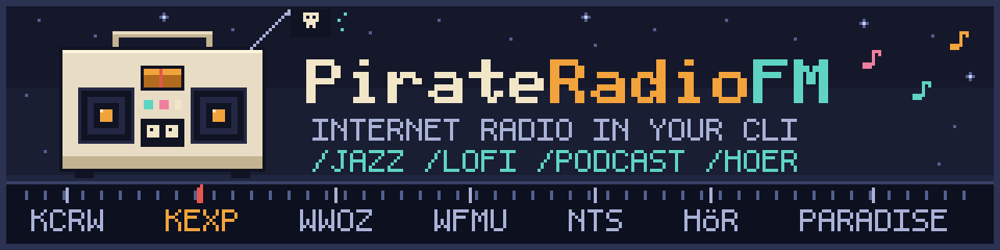

<p align="center"></p>

# PirateRadioFM

在 CLI 编程 agent 里播放网络电台、播客、Spotify 和 Apple Music。

[English](./README.md)

## 安装（Claude Code）

需要 Node.js 20+ 和 `mpv`（或 `ffplay`）：

- Windows：`winget install mpv`
- macOS：`brew install mpv`
- Linux：`sudo apt install mpv`

```bash
claude plugin marketplace add ziwangprincex/PirateRadioFM
claude plugin install radiohead@radiohead
```

重启 Claude Code，在新会话里输 `/` 就能看到命令。

卸载：

```bash
claude plugin uninstall radiohead
claude plugin marketplace remove radiohead
```

## 安装（Codex / OpenCode / Hermes / pi）

```bash
git clone https://github.com/ziwangprincex/PirateRadioFM
cd PirateRadioFM
node install.mjs
```

不带参数时配置本机装了的所有 agent。也可以指定一个：`node install.mjs codex`
（或 `opencode`、`hermes`、`pi`）。`node install.mjs --uninstall` 只删除由安装器
管理且未被用户修改的文件和 MCP 配置项。装完重启对应 agent。

已有同名文件、用户修改过的内容会保留，并输出 `skip`。所有权哈希记录在
`~/.pirate-radio/install-manifest.json`，更新前的备份保存在
`~/.pirate-radio/install-backups/`。旧版安装没有所有权记录，也会被保留；
如需重装，请先备份并手动移走冲突文件或配置项。不要同时运行多个安装器。
本次锁协议升级后，请先退出所有旧 agent 会话，再使用新版本重新启动。

写入的位置：

- Codex：MCP server 写进 `~/.codex/config.toml`，prompts 写进 `~/.codex/prompts/`
- OpenCode：MCP server 写进 `~/.config/opencode/opencode.json`，命令写进 `~/.config/opencode/commands/`
- Hermes：MCP server 写进 `~/.hermes/config.yaml`
- pi：prompt 模板写进 `~/.pi/agent/prompts/`，skill 写进 `~/.pi/agent/skills/radiohead/`

pi 不支持 MCP，因此命令直接调用 `dist/cli.js`。

## 播放控制与并发安全

mpv 通过 JSON IPC 暂停、续播、调音量，不重启播放器；播放器仍存活时，
播客进度会保留。ffplay 继续支持播放，但暂停和实时调音量会明确提示安装
mpv，不会悄悄从头重播。完整控制建议使用 mpv。

网络解析不占用状态锁。HTTP 默认单次 8 秒超时、总重试预算 15 秒；读取
最多重试一次，写入不自动重放。网络和 IPC 共用可取消的 45 秒命令预算，
同步 Music.app 操作另有独立超时。新播放指令会使尚在解析音源的旧请求失效；
已开始执行的播放操作会完成状态提交后，再执行下一条控制命令。

清理按会话 ID、进程启动标识和播放器专属标记定位，不再仅凭电台域名。
默认 CLI 和 MCP 共用一个作用域，同一作用域只允许一个 MCP server 原子
接管。pi 会话自动隔离；多个 MCP 会话可分别设置不同的
`PIRATE_RADIO_SESSION`，配套 CLI 也必须使用同一个值。隔离状态位于
`~/.pirate-radio/sessions/`，Spotify 凭证仍共用；Spotify 和 Music.app
的远程播放设备本身并不独立隔离。

旧版本未登记且没有专属标记的播放器不会被自动清扫，请在升级时手动停止。
加载新版本前，应先退出所有旧会话。

## 命令

### 风格电台

| 命令 | 播放 |
|---|---|
| `/jazz` | 爵士 |
| `/classical` | 古典 |
| `/indie` | 独立流行 / 另类 |
| `/covers` | 翻唱歌曲 |
| `/rock` | 经典 / 专辑摇滚 |
| `/metal` | 金属 |
| `/country` | 乡村 / Americana |
| `/pop` | 流行 / 电子流行 |
| `/ambient` | 氛围 / drone / 太空音乐 |
| `/chill` | 驰放 / 缓拍（`/lofi` 保留为别名） |
| `/soul` | 复古灵魂乐 |
| `/lounge` | lounge / exotica |
| `/eighties` | 80 年代 synthpop / new wave |
| `/world` | 凯尔特与南亚风格世界音乐 |
| `/folk` | 独立 / 另类民谣 |
| `/house` | progressive / deep house |
| `/techno` | techno / IDM |
| `/bass` | dubstep / dub / deep bass |

### DJ / 公共电台

| 命令 | 电台 |
|---|---|
| `/kexp` | KEXP 90.3，西雅图 |
| `/kcrw` | KCRW Eclectic24，洛杉矶 |
| `/wfmu` | WFMU 自由编排电台，新泽西 |
| `/nts` | NTS，伦敦 |
| `/wwoz` | WWOZ，新奥尔良，爵士和蓝调 |
| `/paradise` | Radio Paradise |
| `/public` | 美国公共音乐电台 — The Current、WXPN、KUTX、WFUV（`/next` 轮换；`/npr` 保留为别名） |
| `/hoer` | HÖR 柏林 — 直播时段放 DJ 直播，其余时间放最新场次（[配置指南](./docs/sources.md#hör-berlin)） |

### 播放控制

| 命令 | 作用 |
|---|---|
| `/play` | 播放爵士电台；如果之前暂停了，就恢复播放 |
| `/pause` | 暂停 |
| `/resume` | 恢复播放 |
| `/stop` | 停止。和暂停不同，停止后不能恢复 |
| `/next` | 下一个台 / 频道 / 曲目 |
| `/prev` | 上一个台 / 频道 / 曲目 |
| `/volume <0-100>` | 设置音量 |
| `/now-playing` | 显示正在播放什么 |
| `/doctor` | 诊断播放问题（播放器、yt-dlp、Spotify、电台连通性） |

`/nts`、`/paradise`、`/public` 有多个频道，用 `/next` 切换。

### 播客与流媒体

| 命令 | 作用 |
|---|---|
| `/podcast <名字或RSS地址>` | 播放播客最新一集（iTunes 搜索，无需登录）；`/next`/`/prev` 切集 |
| `/music <名字>` | 播放 Apple Music 资料库里的歌单/歌曲/专辑（仅 macOS） |
| `/spotify-play <任意内容>` | 在你的 Spotify 客户端上播放曲目/专辑/歌单/播客（需 Premium + 配置） |
| `/spotify-search <关键词>` | 搜索 Spotify 目录 |
| `/spotify-devices` / `/spotify-device <名字>` | 列出 Spotify 设备 / 转移播放 |

Spotify 需要一次性配置（开发者 app + 登录）；各音源的细节和限制见
[docs/sources.zh-CN.md](./docs/sources.zh-CN.md)。

直接说话也行："放点爵士"、"换个台"、"停"。

需要手动核验全部内置 stream URL 时，运行 `npm run check:stations`。这个联网检查与普通测试分开，避免临时网络问题影响代码验证。
